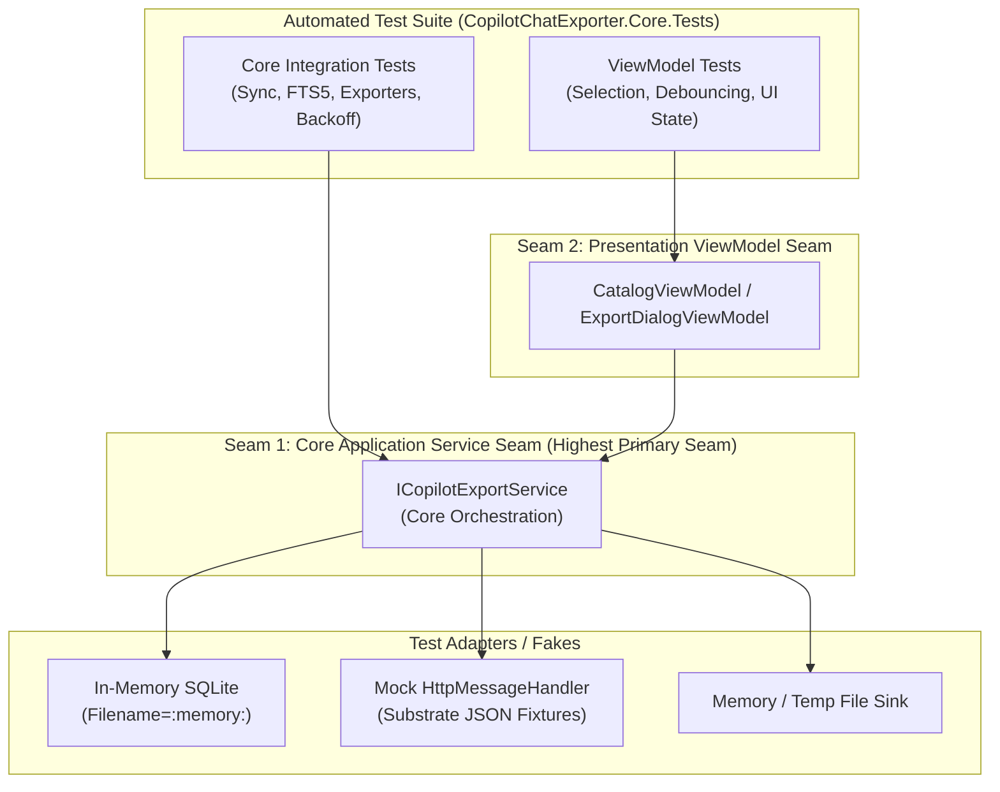

# Feature Specification: M365 Copilot Chat Exporter

Status: ready-for-agent

## Problem Statement

Enterprise professionals and knowledge workers rely daily on Microsoft 365 Copilot (BizChat) to conduct research, synthesize complex company documents, draft communications, analyze internal data, and brainstorm strategies. Over time, these interactions form a rich, indispensable repository of knowledge, institutional decisions, and work history.

However, Microsoft provides no native end-user mechanism for employees to download, browse offline, or archive their conversation history. Enterprise data export APIs provided by Microsoft Graph are restricted to tenant administrators and compliance officers, requiring application-level permissions that typical employees cannot obtain. When projects conclude, employees change roles, or corporate retention policies cycle, valuable insights, prompts, and syntheses are lost. Workers have no practical way to cherry-pick conversations, search past dialogues offline, or export them into clean, human-readable formats like Markdown or self-contained HTML for personal archives, team wikis, Obsidian/Notion vaults, or legal compliance.

## Solution

The **M365 Copilot Chat Exporter** is a multiplatform application built with C# and .NET using Avalonia UI that runs across Windows, macOS, Linux, iOS, and Android. It enables any licensed Microsoft 365 Copilot user to log in via an embedded web session using their standard corporate single sign-on (SSO) and multifactor authentication (MFA)—without needing IT administrator consent.

The application indexes conversation history into a fast, encrypted local database on the user's device, enabling instant full-text search, filtering, and previewing of historical turns and citations. Users can select any combination of conversations—or all of them—and export them into an organized bundle consisting of:
1. Clean GitHub Flavored Markdown files with YAML metadata frontmatter and footnote citations.
2. Self-contained offline HTML documents with responsive speech-bubble styling and automatic light/dark mode support.
3. Complete raw JSON files preserving raw API payloads for machine portability.
4. A master `index.html` catalog file linking to all exported files.
5. Locally downloaded image assets and hyperlinked enterprise document citations.

On desktop systems, files are saved directly to a user-chosen local directory. On mobile devices, the export is packaged into a compressed archive and handed off via the native operating system share sheet. All data processing occurs strictly on the user's local hardware with zero external telemetry.

## User Stories

1. As an enterprise Copilot user, I want to authenticate into my corporate Microsoft 365 account through an embedded login view, so that I can access my chats without requiring IT department approval or administrator consent.
2. As an enterprise user subject to corporate security policies, I want the login view to support my organization's Single Sign-On (SSO), Multifactor Authentication (MFA), and Conditional Access prompts, so that I can sign in securely without violating company policies.
3. As a frequent user, I want the application to securely store my session in my operating system's native credential vault, so that I do not have to sign in with MFA every time I launch the app.
4. As a user whose session has expired, I want the application to detect expired credentials and prompt a seamless re-authentication, so that my workflow is not interrupted by cryptic network errors.
5. As a knowledge worker with a large chat history, I want the app to synchronize my conversations in the background with a visible progress indicator, so that I know how many conversations have been indexed.
6. As a user syncing extensive histories, I want the sync engine to throttle requests and respect Microsoft rate limits, so that my account is not temporarily throttled or blocked by Microsoft 365.
7. As a researcher, I want to view an interactive catalog of all my indexed conversations, so that I can see titles, dates, turn counts, and previous export statuses in one place.
8. As a user looking for a specific past discussion, I want an instant full-text search bar that queries across both user prompts and Copilot responses, so that I can find conversations even if I only remember a fragment of the AI's answer.
9. As a project lead, I want to filter the catalog by date range, so that I can review conversations conducted during a specific sprint, quarter, or milestone.
10. As a user reviewing results, I want to select a conversation and preview its turns in a side drawer, so that I can verify its contents before deciding to export it.
11. As a user previewing a turn, I want to see citations clearly highlighted with titles and source links, so that I know what internal documents or web pages grounded the response.
12. As a user examining a citation, I want clicking the citation link to open the original SharePoint, OneDrive, or web document in my default browser, so that I can inspect the primary source.
13. As a user preparing a periodic backup, I want a "Select All" option and an "Export New / Updated Since Last Export" quick filter, so that I do not waste time manually checking dozens of individual items.
14. As an archivist, I want to export selected conversations into GitHub Flavored Markdown files, so that I can import them into Obsidian, Logseq, Notion, or git repositories.
15. As a markdown user, I want exported Markdown files to include YAML frontmatter with title, timestamps, conversation ID, and turn counts, so that external note-taking tools can parse their metadata.
16. As a reader reviewing Markdown offline, I want citations formatted as standard numerical footnotes at the bottom of the document, so that the main text remains readable while retaining source attribution.
17. As an executive or non-technical colleague, I want conversations exported into self-contained HTML files, so that I can open and read them in any web browser without installing markdown editors.
18. As an offline traveler, I want the HTML files to be 100% self-contained with embedded CSS and zero external CDN dependencies, so that pages render with full visual styling even with no internet connection.
19. As a user working in low-light environments, I want the exported HTML files to adapt automatically to my operating system's light or dark mode, so that viewing exported chats is comfortable on the eyes.
20. As a developer, I want to export conversations as raw JSON files, so that I can feed historical dialogue turns into custom automation scripts or downstream LLM pipelines.
21. As a user exporting multiple conversations, I want a master `index.html` catalog generated at the root of the export folder, so that I can easily navigate and search across all exported conversations from a single dashboard.
22. As a user whose conversations contain generated charts, diagrams, or uploaded images, I want those visual assets downloaded into a local `assets/` subfolder, so that image links in my Markdown and HTML exports do not break when remote temporary links expire.
23. As a desktop user on Windows, macOS, or Linux, I want to choose my destination directory via the native operating system folder picker, so that I can place exported files directly into my preferred local or network drive.
24. As an iOS or Android user, I want the app to package the entire export bundle into a single `.zip` archive and invoke the native share sheet, so that I can save the archive to Apple Files, iCloud, Google Drive, or send it via email.
25. As a security-conscious employee handling proprietary company discussions, I want the application to operate under a strict zero-telemetry policy, so that no conversation snippets, metadata, or analytics ever leave my machine.
26. As an offline user, I want the catalog and previously synced conversations to remain browsable when disconnected from the internet, so that I can reference past Copilot responses on airplanes or during network outages.
27. As a user conducting an export, I want a progress bar indicating how many files have been generated, so that I have clear feedback during large batch operations.
28. As a user who exports regularly, I want the catalog to visually indicate which conversations have already been exported and when, so that I can avoid duplicate work.

## Implementation Decisions

### 1. Multiplatform Framework and Language Choice
The application is implemented in C# targeting .NET 8+ using Avalonia UI. Avalonia UI was selected over .NET MAUI because Avalonia provides first-class, production-ready rendering across all five required platforms: Windows, macOS, Linux, iOS, and Android. Microsoft .NET MAUI does not officially support Linux desktop.

### 2. Clean Layered Architecture
The codebase is partitioned into distinct modules adhering to clean architecture boundaries:
- **Core Domain Module**: Pure .NET library defining domain models (`Conversation`, `Turn`, `Prompt`, `Response`, `Citation`), file export generators (Markdown, HTML, JSON, Master Index), and SQLite repository abstractions. This module has zero dependencies on UI frameworks or platform-specific APIs, making it completely decoupled and unit-testable.
- **Infrastructure Module**: Implements the Microsoft Substrate HTTP client, webview session credential extraction, native secure credential storage adapters (Windows Credential Locker, Apple Keychain, Linux Secret Service, Android KeyStore), and the media asset downloader.
- **Shared Presentation Module**: Avalonia XAML controls, themes, and ViewModels powered by `CommunityToolkit.Mvvm`.
- **Platform Executable Heads**: Minimal startup hosts for Desktop (Windows, macOS, Linux) and Mobile (iOS, Android).

### 3. Authentication via Embedded Webview Session Interception
Rather than relying on the official Microsoft Graph Copilot Export API—which mandates tenant-wide application permissions (`AiEnterpriseInteraction.Read.All`) requiring IT administrator consent—the application extracts data by embedding an `Avalonia.WebView`. The webview navigates to the standard enterprise Copilot chat interface (`https://m365.cloud.microsoft/chat`). Once the user authenticates via Entra ID, the application intercepts active session bearer tokens and cookies directed at Microsoft Substrate endpoints (`https://substrate.office.com/m365Copilot/`).

### 4. Local Persistence and Offline Indexing
The application uses an embedded SQLite database (`Microsoft.Data.Sqlite`) with an FTS5 full-text search index. When the synchronization engine runs, it reconciles remote conversations and turns against the local SQLite store. This supports instant search across conversation titles and turn text, offline catalog browsing, and tracking of historical export timestamps per conversation.

### 5. Resilient Sync Engine
The sync engine throttles outgoing requests to a maximum of 2 concurrent calls and explicitly inspects HTTP 429 response codes. When rate-limited, it parses the `Retry-After` header and executes exponential backoff with random jitter. All network sync operations accept a `CancellationToken` for responsive cancellation.

### 6. Export Formatting Standards
- **Markdown**: Formatted in standard GitHub Flavored Markdown (GFM) with YAML frontmatter. Footnotes (`[^1]`) provide citations linking to a bottom references list.
- **HTML**: Produced as valid HTML5 documents with all CSS embedded inline in `<style>` blocks. CSS includes responsive speech bubbles, typographic hierarchies, and dark mode via `@media (prefers-color-scheme: dark)`. No external fonts, stylesheets, or JavaScript CDNs are linked.
- **JSON**: Formatted using `System.Text.Json` preserving the complete fidelity of conversation turns, timestamps, and citation metadata.
- **Master Index**: An `index.html` file containing a searchable, sortable summary table linking to all generated conversation files.
- **Media Assets**: Images and charts are downloaded into an `assets/` subfolder with cryptographic hash filenames, referenced relatively in Markdown and HTML.

### 7. Delivery Adaptation by Form Factor
- On Desktop platforms (Windows, macOS, Linux), the app interacts with Avalonia's `IStorageProvider` to present a native folder picker, writing individual files directly to disk.
- On Mobile platforms (iOS, Android), files are created in an ephemeral application cache directory, zipped into a single `.zip` file, and dispatched via the native OS Share Sheet.

### 8. Strict Zero Telemetry
The application contains zero telemetry, analytics, or crash-reporting SDKs. Network traffic is strictly limited to official Microsoft domains (`login.microsoftonline.com`, `substrate.office.com`, `m365.cloud.microsoft`).

## Testing Decisions

### What Makes a Good Test
Tests in this codebase must exercise external observable behavior through public module interfaces, never private implementation details or internal methods. A good test sets up input state, invokes an action across a major seam, and asserts on the observable outcome (e.g. database query results, generated file content, formatted markdown strings, or emitted domain events). Tests must not break when internal class structures are refactored, provided behavior remains unchanged.

### Proposed Testing Seams

To adhere to deep-module design principles ("the fewer seams across the codebase, the better — the ideal number is one"), automated testing is concentrated at two high-level seams, with the Core Application Service Seam acting as the primary high seam exercising 95%+ of system behavior:

#### 1. Primary High Seam: The Core Application Service Seam (`ICopilotExportService`)
This is the single highest non-UI seam in the system, connecting domain repositories, export engines, asset downloaders, and sync logic.
- **Adapters Under Test**:
  - `Microsoft.Data.Sqlite` connection configured for in-memory execution (`Filename=:memory:`).
  - Custom `HttpMessageHandler` simulating Microsoft Substrate endpoints and returning realistic JSON fixtures.
  - Ephemeral file sink / temporary directory for file output verification.
- **What This Seam Exercises**:
  - Remote JSON conversation and turn ingestion into SQLite.
  - SQLite FTS5 full-text search across user prompts and Copilot responses.
  - Date-range filtering and catalog pagination queries.
  - Export generation for Markdown (YAML frontmatter, turn formatting, footnote citations).
  - Export generation for 100% self-contained offline HTML (embedded CSS, light/dark mode, air-gapped readiness).
  - Export generation for raw JSON preserving raw metadata.
  - Master `index.html` catalog generation with links to individual conversation files.
  - Media asset downloading and relative link rewriting.
  - Rate-limit backoff handling upon receiving HTTP 429 (`Retry-After`).
  - Incremental sync reconciliation and `LastExportedAt` timestamp updates.

#### 2. Secondary Seam: Presentation ViewModel Seam (`CatalogViewModel`, `ExportDialogViewModel`)
Tested directly via `CommunityToolkit.Mvvm` without launching native windowing heads.
- **Adapters Under Test**: Faked or in-memory `ICopilotExportService`.
- **What This Seam Exercises**:
  - Search input debouncing and query dispatching.
  - Multi-selection toggle logic ("Select All", "Select None", "Select Unexported").
  - Date-range filter bindings.
  - Export dialog options and progress reporting event handling.

### Out of Scope
- Consumer Microsoft accounts (`copilot.microsoft.com`) without a Microsoft 365 Work/School license.
- In-application transient sidebar chats within Microsoft Word, Excel, PowerPoint, or Outlook (these are ephemeral contextual prompts not recorded in the centralized M365 BizChat conversation history).
- Two-way interaction or prompt posting back to Copilot (the application is strictly a read-only catalog browser and exporter).
- Remote cloud backups, centralized multi-tenant databases, or server-hosted sync hubs.
- Automatic recurring background export when the application is closed.

## Further Notes
- Architectural decisions are recorded in `docs/adr/0001` through `docs/adr/0005`.
- Ubiquitous language is codified in `CONTEXT.md` and must be adhered to throughout documentation, code symbols, and test descriptions.
