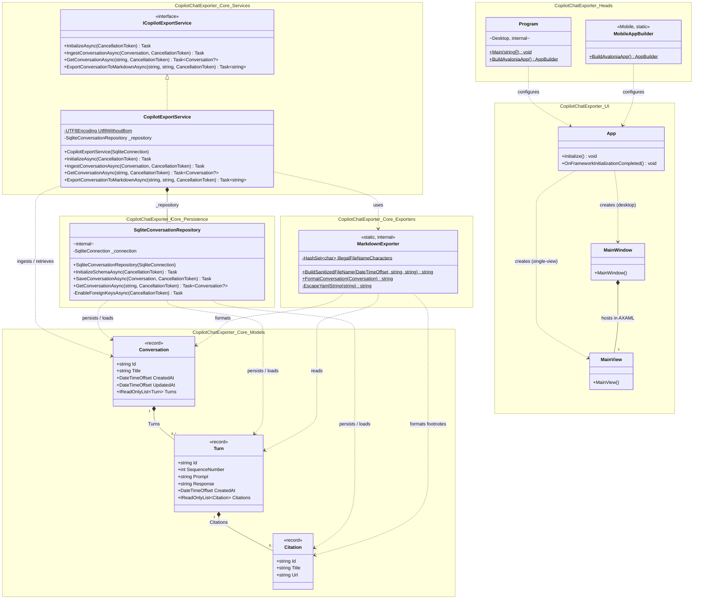

# UML Class Diagram

Here is the UML class diagram of the current codebase across `CopilotChatExporter.Core`, `CopilotChatExporter.UI`, `CopilotChatExporter.Desktop`, and `CopilotChatExporter.Mobile`:

## Summary of Components

- **Domain Models (`CopilotChatExporter.Core.Models`)**
  - [`Conversation`](src/CopilotChatExporter.Core/Models/Conversation.cs): Root aggregate record holding metadata and an ordered list of [`Turn`](src/CopilotChatExporter.Core/Models/Turn.cs) records.
  - [`Turn`](src/CopilotChatExporter.Core/Models/Turn.cs): Immutable record representing a prompt/response exchange and its attached [`Citation`](src/CopilotChatExporter.Core/Models/Citation.cs) list.
  - [`Citation`](src/CopilotChatExporter.Core/Models/Citation.cs): Grounding reference record (`Id`, `Title`, `Url`).
- **Services, Persistence & Exporters (`CopilotChatExporter.Core`)**
  - [`ICopilotExportService`](src/CopilotChatExporter.Core/Services/ICopilotExportService.cs) / [`CopilotExportService`](src/CopilotChatExporter.Core/Services/CopilotExportService.cs): Public service seam coordinating SQLite persistence via [`SqliteConversationRepository`](src/CopilotChatExporter.Core/Persistence/SqliteConversationRepository.cs) and Markdown generation via [`MarkdownExporter`](src/CopilotChatExporter.Core/Exporters/MarkdownExporter.cs).
- **UI & Platform Entrypoints (`CopilotChatExporter.UI`, `Desktop`, `Mobile`)**
  - [`Program`](src/CopilotChatExporter.Desktop/Program.cs) and [`MobileAppBuilder`](src/CopilotChatExporter.Mobile/MobileAppBuilder.cs) bootstrap the Avalonia [`App`](src/CopilotChatExporter.UI/App.axaml.cs), which initializes [`MainWindow`](src/CopilotChatExporter.UI/Views/MainWindow.axaml.cs) (desktop) or [`MainView`](src/CopilotChatExporter.UI/Views/MainView.axaml.cs) (mobile/single-view).
